# CMOS LDO Designer — Low-Power Voltage Regulation and Analog Circuit Optimization

A transistor-level CMOS low-dropout (LDO) regulator designed, simulated, optimized and verified in
**ngspice** with the open-source **SkyWater SKY130** BSIM4 device models, driven entirely from Python.
Every number in this README comes from a simulation that the repository re-runs with
`python run.py all`.

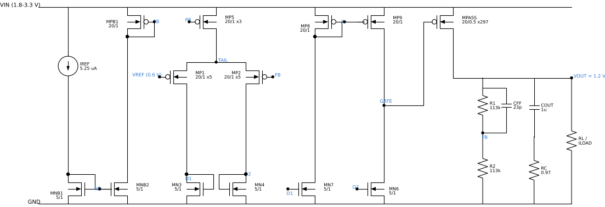

> **Scope, stated up front.** This is a pre-layout, educational design. The transistors use real
> foundry-released SKY130 models (5 V `g5v0d10v5` devices, all five process corners). The voltage
> reference and bias reference current are ideal sources, and the Monte Carlo mismatch statistics
> are documented assumptions, not foundry data. See [Known limitations](#known-limitations).

---

## 1. What an LDO is and why it is used

A **low-dropout regulator** is a linear regulator that holds a constant output voltage while the input
voltage, load current and temperature change, and keeps doing so with very little headroom
(*dropout*) between input and output. Compared with a switching (buck) converter it has no inductor,
no switching ripple, a small area and fast transient response, but its efficiency is bounded by
`Vout/Vin` because the excess voltage is dropped across the pass transistor. LDOs are used to:

* create clean, low-noise supplies for analog/RF blocks, PLLs, ADC references and sensors;
* post-regulate the output of a switching converter (removing its ripple);
* supply always-on, low-current domains where a converter's quiescent current would dominate.

## 2. Architecture and working principle

| # | Block | Implementation (component IDs) | Function |
|---|---|---|---|
| 1 | Voltage reference | `VREF` = 0.6 V (ideal) | Target for the regulation loop |
| 2 | Error amplifier | PMOS-input **symmetrical OTA**: `MP5` tail, `MP1/MP2` pair, `MN3/MN4` diode loads, `MN6/MN7` + `MP8/MP9` output mirrors | Amplifies `FB − VREF` and drives the pass gate rail-to-rail |
| 3 | Pass transistor | `MPASS`, PMOS, 170 × 20 µm/0.5 µm (baseline) | Sources the load current from VIN to VOUT |
| 4 | Feedback divider | `R1`, `R2` | Returns `Vout·R2/(R1+R2)` to the error amp |
| 5 | Bias current source | `IREF` → `MNB1/MNB2` → `MPB1` → `MP5` | Generates the error-amp tail current through current mirrors |
| 6 | Compensation | `COUT` with series `RC`, feed-forward `CFF` across `R1` | Sets loop poles/zeros for stability |
| 7 | Output capacitor | `COUT` = 1 µF | Dominant pole, supplies fast load steps |
| 8 | Load | `RL = 1.2 V / Iload` (DC/AC) or `ILOAD` source (sweeps/steps) | Test load |

**Negative feedback:** if Vout rises, FB rises above VREF, the current in `MP2` falls, `MN6` sinks less
current, the pass gate (`GATE`) rises, `MPASS` conducts less and Vout falls back. In steady state
`V(FB) ≈ VREF`, so `Vout = VREF·(1 + R1/R2)`.

### Why these choices (and one that failed)

* **5 V devices, not 1.8 V core devices.** The input goes up to 3.3 V, above the 1.95 V maximum of the
  SKY130 core transistors, so all transistors are `sky130_fd_pr__{n,p}fet_g5v0d10v5` (thick oxide,
  |Vth| ≈ 0.75–1.0 V).
* **PMOS input pair.** VREF = 0.6 V is below the ~0.75 V threshold of the 5 V NMOS, so an NMOS pair
  would have no headroom for its tail source. The PMOS pair has its bulks tied to the tail node to
  remove the body effect and keep the input common-mode range down to ~0.13 V.
* **Symmetrical OTA instead of a 5-transistor OTA — found by simulation.** The first prototype used a
  plain 5-transistor PMOS OTA. ngspice showed that at Vin = 3.3 V the output sat at 1.6–2.5 V instead
  of 1.2 V: that OTA's output cannot rise above about `VREF + |Vgs| ≈ 1.65 V`, so it cannot turn the
  pass device off when Vin is high. The symmetrical OTA mirrors the pair currents into an output
  branch (`MN6`/`MP9`) that swings from ≈0.05 V to Vin − 0.05 V, which fixed the problem.
* **PMOS pass device.** Its gate can be pulled to ground, giving |Vgs| ≈ Vin, which gives low dropout
  with no charge pump.

## 3. Design equations

| Quantity | Equation |
|---|---|
| Output voltage | `Vout = Vref (1 + R1/R2)` → `R1/R2 = 1.2/0.6 − 1 = 1` |
| Divider current | `Idiv = Vout / (R1 + R2)` (120 k + 120 k → 5 µA) |
| Pass device (triode at dropout) | `ID ≈ µpCox (W/L) [(Vsg − |Vth|) Vsd − Vsd²/2]` |
| Dropout | `Vdo = Vin − Vout` where Vout falls to 98 % of its regulated value |
| EA gain (sym. OTA) | `A_EA = B · gm1 · (ro6 ∥ ro9)`, B = mirror ratio |
| Loop gain | `T(0) = β · A_EA · gm_pass · (ro_pass ∥ R_L ∥ (R1+R2))`, `β = R2/(R1+R2)` |
| Output (dominant) pole | `p_out = 1 / (2π · R_out · Cout)` |
| Gate pole | `p_gate = 1 / (2π · R_o,EA · C_gate)` |
| Rc / ESR zero | `z_rc = 1 / (2π · Rc · Cout)` |
| Feed-forward pair | `z_ff = 1/(2π R1 Cff)`, `p_ff = 1/(2π (R1∥R2) Cff)` |
| Line regulation | `ΔVout/ΔVin` (mV/V) over 1.8–3.3 V |
| Load regulation | `ΔVout/ΔIload` (mV/mA) over 1–50 mA |
| Efficiency | `η = Vout·Iload / (Vin·Iin) × 100`, bounded by `Vout/Vin` |
| Ground / quiescent current | `Ignd = Iin − Iload`; `Iq = Iin` at `Iload = 0` |

**Compensation strategy.** With a 1 µF external capacitor the output node is necessarily the dominant
pole (at 1 mA, `R_L` = 1.2 kΩ, so `p_out` ≈ 130 Hz). The pass gate is a large capacitance driven by a
high-impedance OTA output, so `p_gate` is only tens of kHz, below the unity-gain frequency. A series
resistance `RC` (or the capacitor ESR) adds the zero `z_rc` that cancels the phase lag of `p_gate`
before crossover. Section 6 shows how strongly the phase margin depends on `RC`.

## 4. Repository structure

```
cmos-ldo-designer/
├── circuits/        design_params (dataclasses, PDK bins), components, one module per block,
│                    ldo_topology (assembly + component table)
├── spice/           netlist_generator, ngspice_runner, dc/ac/transient_analysis, result_parser
├── optimization/    transistor_sizing (sim-backed hand calcs), parameter_sweep, design_optimizer (DE)
├── verification/    pvt_analysis, monte_carlo, stability_analysis, spec_check
├── analysis/        performance_metrics, power_analysis, regulation_analysis, characterization,
│                    plotting, schematic, report_generator, experiment_store (SQLite)
├── dashboard/app.py Streamlit dashboard
├── pdk/sky130_hv/   minimal SKY130 model set (5 V nfet/pfet, 5 corners, Apache-2.0)
├── results/         CSV waveforms, metrics.json, plots per design
├── experiments/     experiments.db (every simulation-based experiment)
├── reports/         design_report.md / .html
├── tests/           pytest (unit + ngspice integration)
└── run.py           command-line pipeline
```

## 5. SPICE simulation workflow

1. `circuits/*` build a list of `Component`s (unique ID, nodes, value, block, function) from an
   `LDODesign` dataclass. W/L pairs are checked against the PDK bin table, because the SKY130 BSIM4
   cards are binned and only characterized geometries are valid.
2. `spice/netlist_generator.py` wraps the regulator in a test bench (`.lib` corner, `.temp`, sources,
   load, `.control` block). The netlist for each analysis is generated, never hand-edited.
3. `spice/ngspice_runner.py` detects ngspice (`PATH` or `$NGSPICE`), runs it in batch mode in a temp
   folder with the PDK linked in, fails loudly on simulator errors (singular matrix, timestep too
   small, missing model bin…) and returns printed values plus every `wrdata` table.
4. `spice/result_parser.py` parses output, classifies transistor regions from BSIM4 operating-point
   data (`vgs`, `vds`, `vth`, `vdsat`), and rejects NaN/Inf or truncated data before anything is saved.
5. `analysis/*` compute metrics from the waveforms (PM, GM, UGF, regulation, dropout, overshoot,
   settling, efficiency…). `tests/test_metrics.py` checks these extractors against analytic cases.

**Loop-gain measurement:** the loop is broken at the error-amp input. A 1 GH inductor closes it at
DC so the bias point is correct, and a 1 GF capacitor injects the AC test signal:
`T(s) = −V(FB)/V(FBIN)`.

## 6. Transistor sizing

**Feedback divider.** `R1/R2 = 1.2/0.6 − 1 = 1`. The baseline uses 120 k + 120 k (5 µA divider
current, small next to the 1 mA minimum load); the optimizer settled on 113 k + 113 k (5.3 µA).

**Pass device, sized from simulation rather than a textbook k'.** `optimization/transistor_sizing.py`
simulates one 20 µm/0.5 µm finger at the worst intended bias: Vin = 1.8 V, Vsd = 0.5 V, gate at 0.15 V
(the error amp's low swing limit). It then computes the fingers needed for 1.2 × 50 mA in every corner
and temperature (`results/sizing_pass_device.csv`):

| corner / temp | I per finger | fingers needed |
|---|---|---|
| tt, 27 °C | 0.354 mA | 170 → baseline choice |
| ss, −40 °C | 0.242 mA | 249 |
| sf, −40 °C (worst) | 0.216 mA | 278 |
| fs, 27 °C (best) | 0.478 mA | 126 |

So the 170-finger baseline is right at nominal but predicted to fall short in slow-PMOS cold corners.
The PVT run confirmed this (Section 9). The optimized design uses **297 fingers (W = 5.94 mm)**.

**Error amplifier.** Bias currents come from `IREF` (5–5.25 µA) through 1:1 NMOS mirrors and a PMOS
mirror with tail ratio `m_tail` (baseline 2 → about 10 µA tail; optimized 3 → about 16 µA). Input pair
20/1 µm × 2 (baseline) or × 5 (optimized). Loads and mirrors are 5/1 µm NMOS and 20/1 µm PMOS
(B = 1). All W/L pairs are characterized SKY130 bins. Measured stand-alone error-amp performance
(Vin = 2.5 V, 5 pF load):

| | baseline | optimized |
|---|---|---|
| DC differential gain | 38.9 dB | 39.4 dB |
| GBW | 2.79 MHz | 4.61 MHz |
| Systematic input offset | −1.33 mV | −0.96 mV |
| Input common-mode range (follower slope ≥ 0.9) | 0.135 – 2.11 V | 0.15 – 2.11 V |
| Output swing | 0.057 – 2.456 V | 0.061 – 2.450 V |
| Supply current / power | 30.6 µA / 76.6 µW | 42.9 µA / 107 µW |

Per-transistor operating points (Id, gm, gds, Vgs, Vds, Vth, Vdsat, Cgg, region) are in
`results/<design>/device_operating_points.csv` and in the dashboard's Circuit Explorer.

## 7. Simulation results (tt, 27 °C)

| Metric | Baseline | Optimized | Target / limit |
|---|---|---|---|
| Vout at 2.5 V, 10 mA | 1.1990 V (−0.08 %) | **1.2006 V (+0.05 %)** | 1.2 V ± 2 % |
| Line regulation, 1.8–3.3 V, 1 mA / 50 mA | 0.25 / 6.47 mV/V | **0.08 / 2.96 mV/V** | ≤ 10 mV/V |
| Load regulation 1→50 mA at 1.8 / 2.5 / 3.3 V | −0.344 / −0.184 / −0.154 mV/mA | **−0.204 / −0.130 / −0.111 mV/mA** | ≤ 0.5 mV/mA |
| Dropout at 1 / 10 / 50 mA | 0.026 / 0.158 / 0.509 V | **0.015 / 0.102 / 0.336 V** | ≤ 0.6 V |
| Max load at Vin = 1.8 V (Vout ≥ 98 %) | 63 mA | **111 mA** | ≥ 50 mA |
| Quiescent current at 1.8 / 3.3 V, no load | 31.3 / 38.6 µA | 41.8 / 52.7 µA | ≤ 100 µA |
| Worst phase margin (9 Vin/load points) | 53.7° | **68.1°** | ≥ 45° |
| Worst gain margin | 63.3 dB | 52.0 dB | ≥ 10 dB |
| Loop UGF range | 63–334 kHz | 78–768 kHz | — |
| PSRR at DC / 1 kHz / 100 kHz | −59.8 / −59.7 / −38.3 dB | **−65.0 / −64.8 / −41.2 dB** | — |
| Load step 1→50→1 mA (1 µs edges), Vin 2.5 V | −34.1 / +25.1 mV | **−26.1 / +20.5 mV** | ≤ 60 mV |
| Settling to ±3 mV (step up / down) | 3.1 / 13.0 µs | **1.9 / 5.4 µs** | — |
| Load step at Vin = 1.8 V | −40.9 / +33.5 mV | −34.2 / +26.2 mV | — |
| Line step 1.8→3.3→1.8 V (1 µs), 10 mA | +17.6 / −14.4 mV | +18.0 / −15.0 mV | — |
| Efficiency 1.8 V at 1 mA / 50 mA | 64.8 / 65.8 % | 64.2 / 66.2 % | Vout/Vin limit 66.7 % |
| Efficiency 3.3 V at 50 mA | 36.2 % | 36.3 % | limit 36.4 % |

Efficiency is essentially set by `Vout/Vin`. At 50 mA the ground current costs only about 0.1 % of
efficiency; at 1 mA the 40–50 µA quiescent current costs about 4 %.

**Poles and zeros** (hand-analysis formulas fed with simulated gds/gm/Cgg, optimized design, Vin = 2.5 V):
p_out ≈ 202 Hz (1 mA) → 8.3 kHz (50 mA); p_gate ≈ 38–59 kHz; z_rc = 164 kHz; z_ff = 61 kHz and
p_ff = 122 kHz. This matches the simulated Bode plot: phase falls to about −110° at tens of kHz, and the
Rc and Cff zeros pull it back toward −95° around crossover.

| | |
|---|---|
| 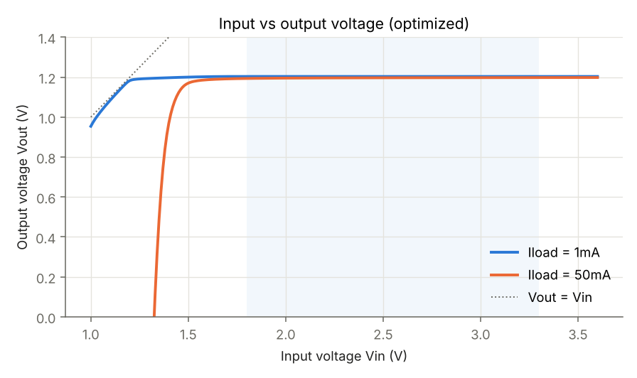 | 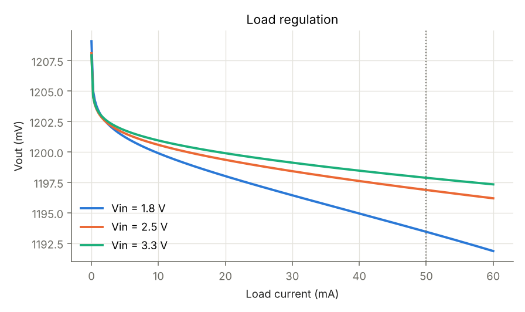 |
| 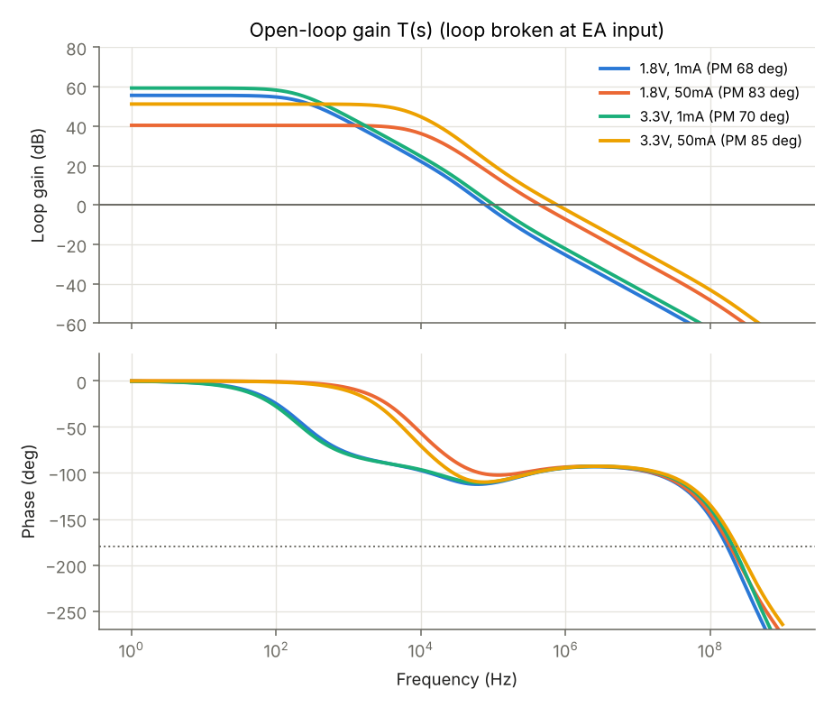 | 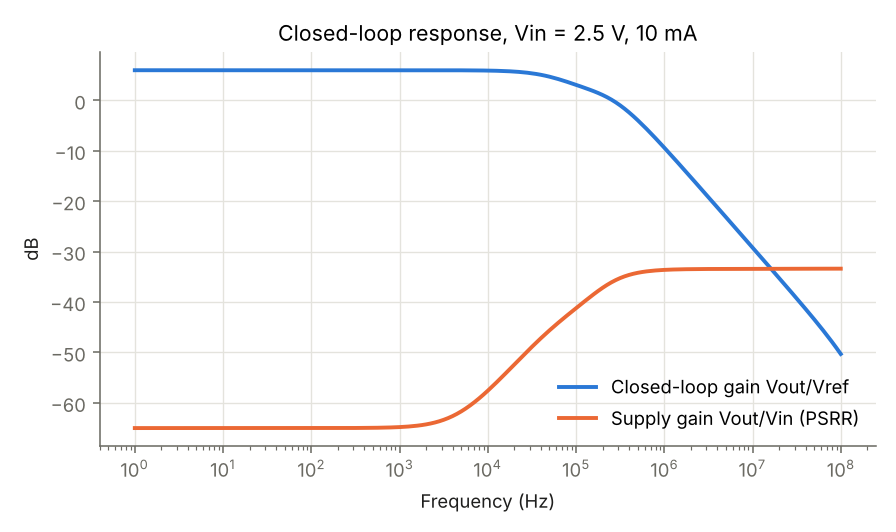 |
| 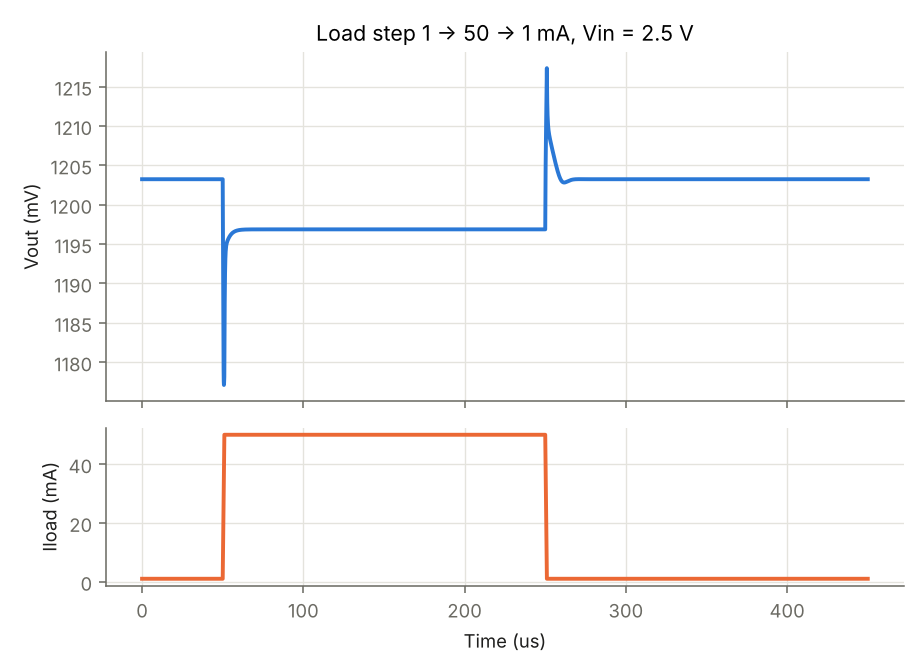 | 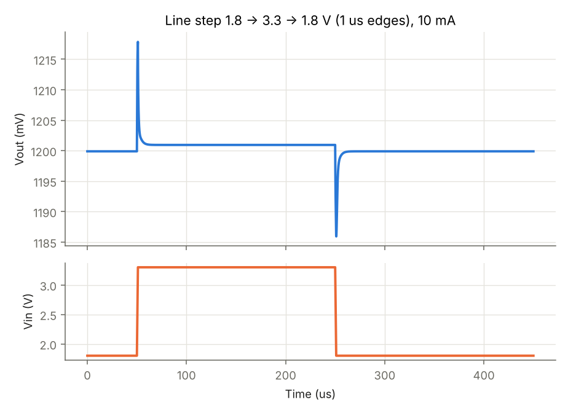 |
| 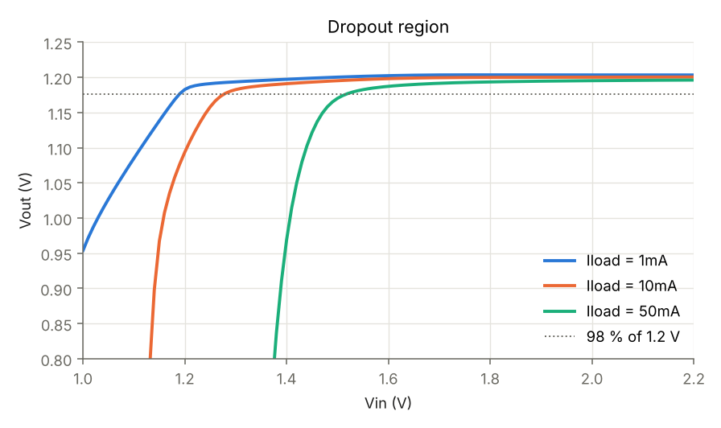 | 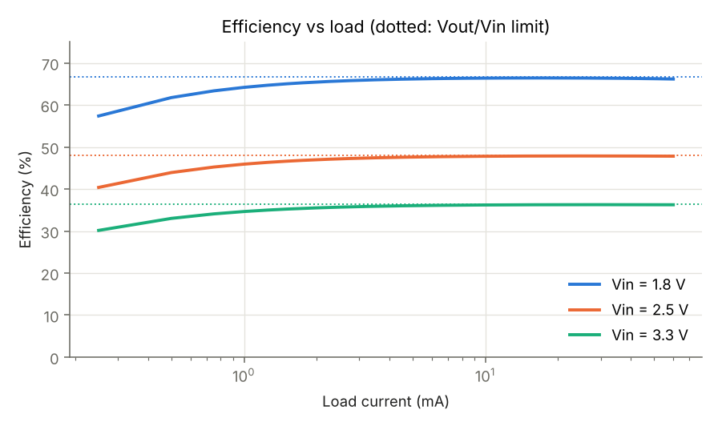 |
| 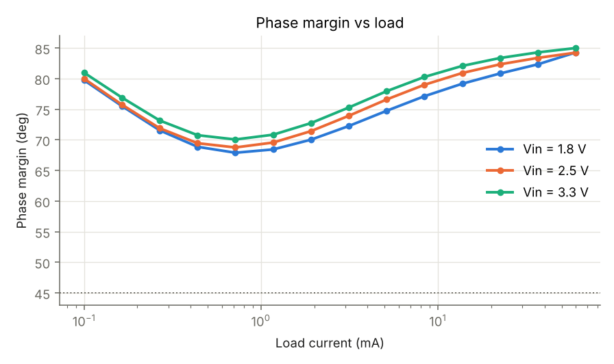 | 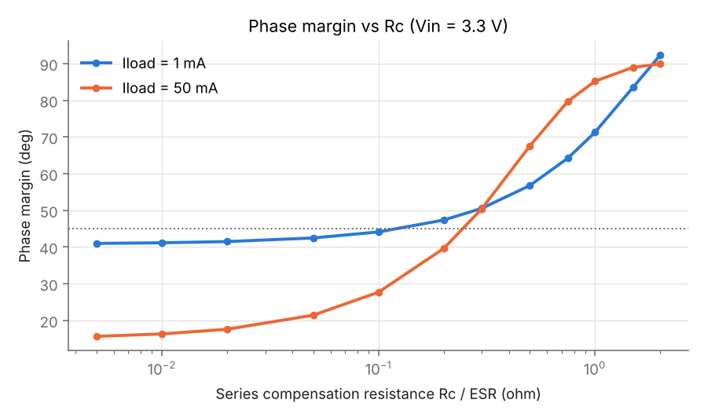 |

### The most important trade-off: stability depends on Rc / ESR

`pm_vs_rc.png` sweeps the series resistance in series with Cout (Vin = 3.3 V). In the optimized
design, PM at 50 mA goes from about 16° at Rc = 5 mΩ, to 45° at about 0.25 Ω, to 85° at 1 Ω. A bare
1 µF ceramic capacitor (ESR around 10 mΩ) would make this regulator nearly unstable at heavy load. The
design therefore specifies an explicit 0.97 Ω series resistor (or a capacitor with that ESR). The
price is a resistive step of about Rc·ΔI ≈ 48 mV at the edge, filtered by the loop, which is visible
as the narrow spike on the load step. Removing that dependence (buffered pass gate, Miller or
current-feedback compensation) is the most valuable next step.

## 8. Optimization methodology

1. **Sensitivity sweeps** (`python run.py sweeps`, `results/sweeps/`): one parameter at a time around the
   baseline, each point a full 4-corner (Vin × load) evaluation.

   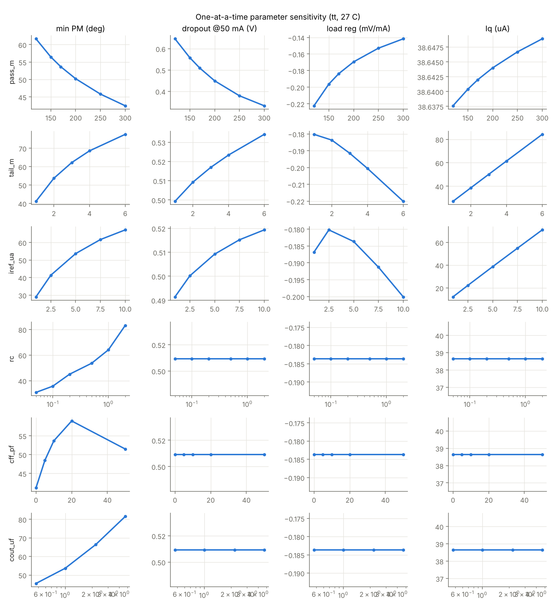

   Findings: more pass fingers lower dropout (0.65 → 0.33 V for 120 → 300 fingers) but cost phase
   margin (62° → 42°), because the larger gate capacitance lowers p_gate. More tail current raises PM
   and Iq roughly linearly. Rc and Cout mostly affect stability. Cff helps up to about 20 pF, then
   hurts as its pole p_ff moves into the crossover region.
2. **Differential evolution** (`optimization/design_optimizer.py`, SciPy, integer-aware) over 7 variables:
   pass fingers (120–300), pair fingers (1–6), tail fingers (1–6), Iref (1–10 µA), Rc (0.1–1 Ω),
   Cff (0–50 pF), R1+R2 (60–600 k). Each candidate is simulated at Vin = 1.8/3.3 V × 1/50 mA (loop gain +
   DC), plus 2.5 V load regulation, no-load Iq, dropout at **tt/27 °C and at sf/−40 °C** (the worst pass
   corner found in Section 6), and a 1→50 mA load step. The cost is a weighted sum of normalized PM
   shortfall, dropout, |load reg|, Iq, undershoot, worst Vout error and pass-device area, plus hard
   penalties for PM < 45°, GM < 10 dB, dropout > 0.6 V and error > 2 %. 288 candidates were simulated;
   every one is stored in `experiments/experiments.db`. Best cost: 8.55 (baseline) → 5.88.
3. The optimizer's continuous values were rounded to buildable ones (Iref 5.25 µA, Rc 0.97 Ω,
   Cff 23 pF, R1 = R2 = 113 k), and the rounded design was re-simulated end to end. All numbers above
   are for the rounded design.

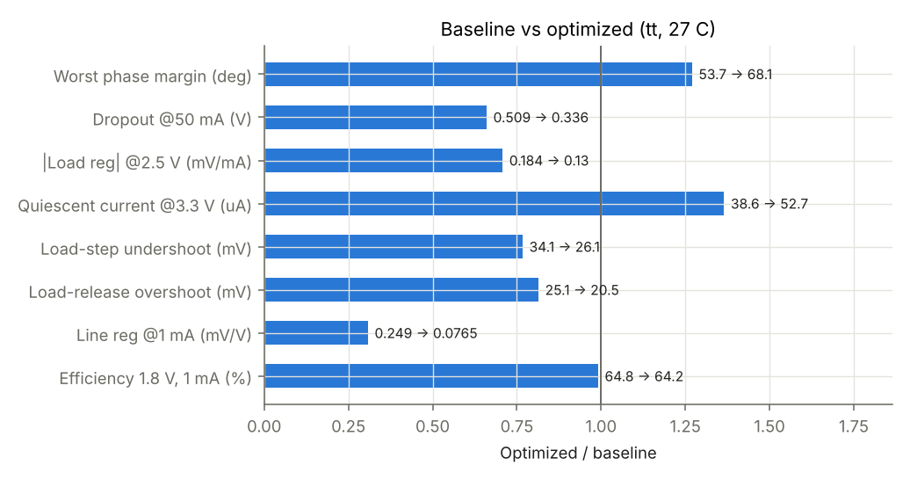

Improvements: worst phase margin +14°, dropout −34 %, load-step undershoot −23 %, load regulation
−29 %, line regulation 3×, PSRR +5 dB. Cost: Iq +36 % (38.6 → 52.7 µA) and a 1.75× larger pass device.

## 9. PVT and Monte Carlo verification

**PVT**: 5 SKY130 corners (tt, ff, ss, fs, sf) × 4 temperatures (−40, 27, 85, 125 °C) × 3 supplies
(1.8, 2.5, 3.3 V) × 2 loads (1, 50 mA) = 120 operating points with DC and loop-gain analysis each, plus
Iq and dropout per corner/temperature. No simulation failed.

| PVT result | Baseline | Optimized | Limit |
|---|---|---|---|
| Vout range | 1.1662 – 1.2046 V | **1.1883 – 1.2062 V** | 1.176 – 1.224 V |
| Worst Vout error | **2.82 % (FAIL)** | 0.97 % | 2 % |
| Worst phase margin | **29.8° (FAIL)** at sf/−40 °C/1.8 V/1 mA | 46.4° at the same corner | 45° |
| Worst gain margin | 61.1 dB | 50.0 dB | 10 dB |
| Worst dropout at 50 mA | **0.642 V (FAIL)** | 0.476 V | 0.6 V |
| Worst Iq | 40.3 µA | 55.3 µA | 100 µA |

The baseline's PVT failures are what drove the optimizer's worst-corner dropout term. The
optimized design passes every PVT check, but at 46.4° it has only 1.4° of margin in the sf/−40 °C
corner. That is the next thing to improve.

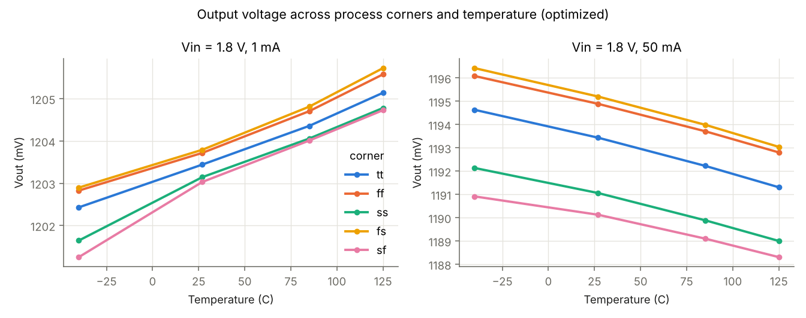
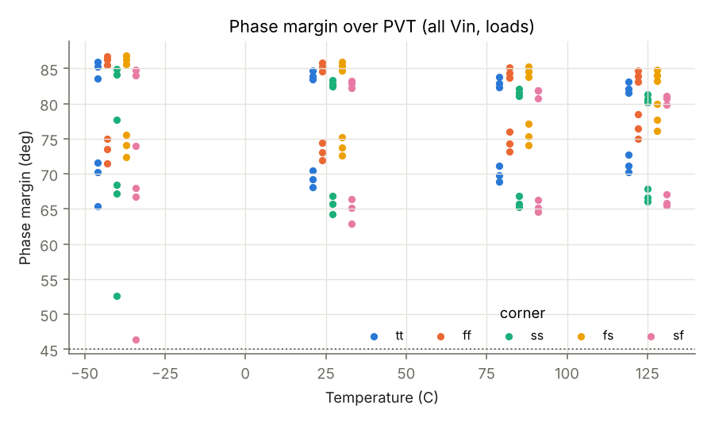

**Monte Carlo** (200 samples, tt, 27 °C, seed 2026). The model is **educational**: the SKY130 5 V
model cards only expose global mismatch switches, so per-device foundry mismatch cannot be used in
ngspice here. Assumed: Pelgrom A_VT = 8 mV·µm on every transistor (as a gate-offset source),
σ(R)/R = 0.25 % per resistor, σ(Vref) = 0.5 %, σ(Iref) = 5 %.

| Result | Optimized |
|---|---|
| Vout mean / σ | 1.2011 V / 11.2 mV |
| Vout min / max | 1.1737 / 1.2305 V |
| EA input-referred error σ | 4.81 mV |
| Tail current mean / σ | 15.9 / 1.37 µA |
| Ground current mean / σ | 48.2 / 3.4 µA |
| Phase margin min / mean (1.8 V/50 mA and 3.3 V/1 mA) | 65.4° / 70.3° |
| **Yield** (|err| ≤ 2 % and PM ≥ 45°) | **97.5 %** (95 % Wilson CI 94.3–98.9 %) |

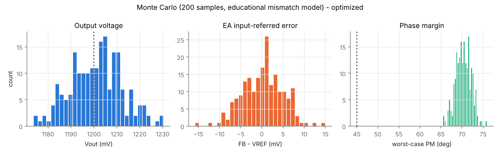

**Why the yield misses the 99 % target.** Stability is never the problem (minimum PM 65°). The misses
are accuracy failures. σ(Vout) = 11.2 mV is consistent with the root-sum-square of the Vref term
(0.5 % × 1.2 V = 6 mV) and twice the EA offset (2 × 4.8 mV = 9.6 mV); the factor 2 is 1/β. The EA
offset is dominated by the small 5 µm × 1 µm NMOS loads and mirrors (σVth ≈ 3.6 mV each), not by the
large input pair. `experiments/mismatch_tradeoff.py` tests the obvious fix: 4× longer and 4× wider
mirrors (5/4 µm × 4). Over 60 samples this halves the offset (σ 4.52 → 2.30 mV) and cuts σ(Vout) from
10.6 to 6.6 mV. But the larger mirror capacitance lowers the worst-case PVT phase margin from 46.4° to
**40.6°**, which fails the 45° limit, so the change was **not adopted**. Fixing both needs either
trimming of Vref/offset or a compensation scheme less sensitive to the gate pole.

## 10. Validation summary

Generated by `verification/spec_check.py` → `results/spec_compliance.csv`:

| Test | Measured (optimized) | Result |
|---|---|---|
| 1. Output accuracy, nominal / PVT | 1.2006 V (+0.05 %) / max 0.97 % | PASS |
| 2. Line regulation | 2.96 mV/V worst | PASS |
| 3. Load regulation | 0.204 mV/mA worst | PASS |
| 4. Dropout @ 50 mA, nominal / PVT | 0.336 V / 0.476 V | PASS |
| 5. Efficiency | 66.2 % @ 1.8 V (limit 66.7 %) | PASS |
| 6. Quiescent current, nominal / PVT | 52.7 µA / 55.3 µA | PASS |
| 7. Phase margin, nominal / PVT | 68.1° / 46.4° | PASS (thin at PVT) |
| 8. Gain margin | 52.0 dB | PASS |
| 9. Load transient | −26.1 / +20.5 mV | PASS |
| 10. Temperature variation (tt) | 14.0 mV span, −40…125 °C, all Vin/loads | PASS |
| 11. Parameter sensitivity | `results/sweeps/` | INFO |
| 12. Monte Carlo yield | 97.5 % | **FAIL** (target 99 %, see Section 9) |

## 11. Installation and execution

Requirements: Python ≥ 3.11 and ngspice (tested with ngspice-42). The SKY130 model subset is bundled
in `pdk/sky130_hv/`, so no separate PDK install is needed.

```bash
# 1. ngspice
brew install ngspice                 # macOS
sudo apt-get install ngspice         # Ubuntu / Debian
# Windows: install from https://ngspice.sourceforge.io and add to PATH (or set NGSPICE=path\to\ngspice.exe)

# 2. Python environment
cd cmos-ldo-designer
python3 -m venv .venv && source .venv/bin/activate
pip install -r requirements.txt

# 3. Check everything is detected
python run.py check

# 4. Reproduce
python run.py baseline      # ~40 s  full characterisation of the baseline
python run.py sweeps        # ~2 min sensitivity sweeps
python run.py optimize      # ~25 min differential evolution (results/optimizer_result.json)
python run.py optimized     # ~40 s  characterise the optimized design
python run.py pvt --design optimized          # ~1.5 min
python run.py montecarlo --design optimized   # ~3 min (200 samples)
python run.py report        # spec table, comparison, reports/design_report.{md,html}
python run.py all --reuse   # all of the above, reusing a saved optimizer result

# 5. Dashboard
python run.py dashboard     # or: streamlit run dashboard/app.py

# 6. Tests (unit tests + real ngspice integration tests)
python -m pytest -q

# Docker
docker build -t cmos-ldo . && docker run -p 8501:8501 cmos-ldo
```

Runtimes were measured on a 2-vCPU cloud VM. `--workers N` runs N ngspice processes in parallel. Use
it only when you have spare physical cores: on the shared vCPUs used here, parallel runs were about
10× slower each, so the default is 1. ngspice is pinned to one OpenMP thread per process
(`LDO_OMP_THREADS` overrides this).

**Dashboard pages:** Overview (KPIs and the spec table), Circuit Explorer (schematic, component IDs,
per-device operating points, netlist), Simulation Laboratory (choose Vin, load, corner, temperature,
Cout, Rc, Cff, transistor sizes; run DC/AC/transient live; compare configurations), Visualization
(interactive Plotly versions of every plot, baseline vs optimized), PVT & Monte Carlo, Design Report
(regenerate and download HTML/Markdown), Experiments (SQLite log, optimizer convergence).

## Known limitations

- **Reference and bias current are ideal sources.** A transistor-level bandgap would need the SKY130
  parasitic PNP models, which are outside the bundled model subset. Their spread is covered only
  statistically (Monte Carlo).
- **Compensation relies on Rc ≈ 1 Ω in series with Cout** (Section 7). With a low-ESR ceramic capacitor
  and no series resistor, the phase margin collapses.
- **Monte Carlo statistics are assumptions, not foundry data** (A_VT, resistor and reference sigmas
  above). Global process spread is covered only by the five PDK corners.
- Worst-case PVT phase margin is 46.4°, only just above the 45° limit, and MC yield is 97.5 % against a
  99 % target.
- Pre-layout only: no parasitic extraction, no package/bond-wire inductance, no ESD, current limit,
  thermal shutdown or soft-start. R and C are ideal (no corners or tempco). Dropout is defined at 98 %
  of the regulated output.
- Loop gain uses an L/C loop break at the error-amp input (accurate in the band of interest, but not a
  bidirectional Middlebrook/Tian measurement). Gain margins above 50 dB come from parasitic poles near
  100 MHz, where model accuracy is lower; treat them as "large", not as exact numbers.
- Max load at 3.3 V shows as 200 mA only because that is the sweep limit.

## License and credits

The SKY130 device models in `pdk/sky130_hv/` are from
[google/skywater-pdk-libs-sky130_fd_pr](https://github.com/google/skywater-pdk-libs-sky130_fd_pr)
under the Apache-2.0 license (copy included). The project code is provided for educational use.
