# CMOS LDO Designer - Design Report

*Generated from ngspice 42 simulations with the open-source SkyWater SKY130 5 V device models (`nfet/pfet_g5v0d10v5`). Final design: **optimized**.*

## 1. Circuit architecture

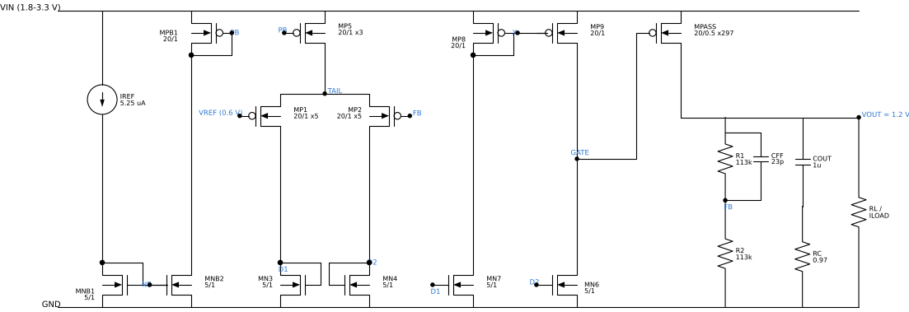

- **Bias & reference** - 0.6 V reference and bias-current generation with NMOS/PMOS current mirrors.
- **Error amplifier** - PMOS-input symmetrical OTA comparing FB with VREF and driving the pass gate rail-to-rail.
- **Pass device** - Large PMOS transistor that sources the load current from VIN to VOUT.
- **Feedback network** - Resistor divider returning Vout/2 to the error amplifier.
- **Compensation** - Output capacitor with series resistance (zero) and feed-forward capacitor.

## 2. Design specifications (targets)

| Parameter | Target |
|---|---|
| Input voltage | 1.8 - 3.3 V |
| Output voltage | 1.2 V |
| Load current | 1 - 50 mA |
| Reference | 0.6 V |
| Output capacitor | 1 uF |
| Acceptance limits | vout_accuracy_pct=2.0, phase_margin_min_deg=45.0, gain_margin_min_db=10.0, line_reg_max_mv_per_v=10.0, load_reg_max_mv_per_ma=0.5, dropout_max_v=0.6, iq_max_ua=100.0, load_step_dev_max_mv=60.0 |

## 3. Transistor sizing (final design)

| ref | block | type | value | nodes | function |
|---|---|---|---|---|---|
| VREF | Bias & reference | V | DC 0.6 | vref 0 | 0.6 V reference voltage (ideal, see limitations) |
| IREF | Bias & reference | I | DC 5.250000e-06 | vin nb | Reference bias current (ideal, stands in for bandgap current) |
| MNB1 | Bias & reference | nmos | 5/1 x1 | nb nb 0 0 | Diode-connected NMOS: converts IREF to bias voltage NB |
| MNB2 | Bias & reference | nmos | 5/1 x1 | pb nb 0 0 | NMOS mirror: copies IREF into the PMOS bias diode |
| MPB1 | Bias & reference | pmos | 20/1 x1 | pb pb vin vin | Diode-connected PMOS: generates tail bias voltage PB |
| MP5 | Error amplifier | pmos | 20/1 x3 | tail pb vin vin | Tail current source of the differential pair |
| MP1 | Error amplifier | pmos | 20/1 x5 | d1 vref tail tail | Input transistor, inverting input (VREF) |
| MP2 | Error amplifier | pmos | 20/1 x5 | d2 fb tail tail | Input transistor, non-inverting input (feedback FB) |
| MN3 | Error amplifier | nmos | 5/1 x1 | d1 d1 0 0 | Diode load of MP1 |
| MN4 | Error amplifier | nmos | 5/1 x1 | d2 d2 0 0 | Diode load of MP2 |
| MN6 | Error amplifier | nmos | 5/1 x1 | gate d2 0 0 | Output pull-down: mirrors MP2 current (xB) |
| MN7 | Error amplifier | nmos | 5/1 x1 | x d1 0 0 | Mirrors MP1 current (xB) into PMOS mirror |
| MP8 | Error amplifier | pmos | 20/1 x1 | x x vin vin | PMOS mirror diode |
| MP9 | Error amplifier | pmos | 20/1 x1 | gate x vin vin | Output pull-up: mirrors MP8 current; drives pass gate |
| MPASS | Pass device | pmos | 20/0.5 x297 | vout gate vin vin | PMOS pass transistor delivering load current |
| R1 | Feedback network | R | 1.130000e+05 | vout fb | Upper feedback resistor |
| R2 | Feedback network | R | 1.130000e+05 | fb 0 | Lower feedback resistor |
| COUT | Compensation | C | 1.000000e-06 | vout co | Output capacitor |
| RC | Compensation | R | 9.700000e-01 | co 0 | Series compensation resistance / ESR (creates LHP zero) |
| CFF | Compensation | C | 2.300000e-11 | vout fb | Feed-forward capacitor across R1 (zero/pole pair) |

Feedback: R1 = 113 k, R2 = 113 k -> Vout = 0.6 x (1 + R1/R2) = 1.200 V; Cff = 23 pF, Rc = 0.97 ohm, Cout = 1 uF, Iref = 5.25 uA.

Pass-device fingers needed for 1.2 x 50 mA at Vin = 1.8 V, Vsd = 0.5 V, gate at 0.15 V (simulated per corner):

| corner | temp | i_finger_ma | fingers_required | ron_ohm_per_finger |
|---|---|---|---|---|
| tt | -40.0 | 0.336 | 179 | 1488.795 |
| tt | 27.0 | 0.354 | 170 | 1412.246 |
| tt | 125.0 | 0.371 | 162 | 1349.094 |
| ff | -40.0 | 0.446 | 135 | 1122.125 |
| ff | 27.0 | 0.451 | 134 | 1109.048 |
| ff | 125.0 | 0.453 | 133 | 1103.87 |
| ss | -40.0 | 0.242 | 249 | 2070.299 |
| ss | 27.0 | 0.268 | 224 | 1866.11 |
| ss | 125.0 | 0.295 | 204 | 1695.57 |
| fs | -40.0 | 0.48 | 126 | 1042.32 |
| fs | 27.0 | 0.478 | 126 | 1046.875 |
| fs | 125.0 | 0.472 | 128 | 1058.983 |
| sf | -40.0 | 0.216 | 278 | 2312.363 |
| sf | 27.0 | 0.246 | 244 | 2029.196 |
| sf | 125.0 | 0.278 | 216 | 1796.952 |

## 4. Simulation results

### baseline

| Metric | Value |
|---|---|
| Vout (2.5 V, 10 mA) | 1.1990 V |
| Quiescent current (3.3 V, no load) | 38.6 uA |
| Line regulation (1 mA / 50 mA) | 0.249 / 6.47 mV/V |
| Load regulation (1.8/2.5/3.3 V) | -0.344 / -0.184 / -0.154 mV/mA |
| Dropout (1/10/50 mA) | 0.0258 / 0.158 / 0.509 V |
| Max load at 1.8 V (Vout >= 98 %) | 63 mA |
| Min phase margin / gain margin | 53.7 deg / 63.3 dB |
| EA DC gain / GBW (5 pF) | 38.9 dB / 2.79 MHz |
| EA systematic offset | -1.33 mV |
| PSRR @ DC / 1 kHz / 100 kHz | -59.8 / -59.7 / -38.3 dB |
| Load step 1->50->1 mA (2.5 V) | -34.1 / +25.1 mV, settling 3.05 / 13 us |
| Efficiency 1.8 V @ 1 / 50 mA | 64.8 / 65.8 % |

### optimized

| Metric | Value |
|---|---|
| Vout (2.5 V, 10 mA) | 1.2006 V |
| Quiescent current (3.3 V, no load) | 52.7 uA |
| Line regulation (1 mA / 50 mA) | -0.0765 / 2.96 mV/V |
| Load regulation (1.8/2.5/3.3 V) | -0.204 / -0.13 / -0.111 mV/mA |
| Dropout (1/10/50 mA) | 0.0151 / 0.102 / 0.336 V |
| Max load at 1.8 V (Vout >= 98 %) | 111 mA |
| Min phase margin / gain margin | 68.1 deg / 52.0 dB |
| EA DC gain / GBW (5 pF) | 39.4 dB / 4.61 MHz |
| EA systematic offset | -0.963 mV |
| PSRR @ DC / 1 kHz / 100 kHz | -65.0 / -64.8 / -41.2 dB |
| Load step 1->50->1 mA (2.5 V) | -26.1 / +20.5 mV, settling 1.85 / 5.35 us |
| Efficiency 1.8 V @ 1 / 50 mA | 64.2 / 66.2 % |

### Waveforms (final design)

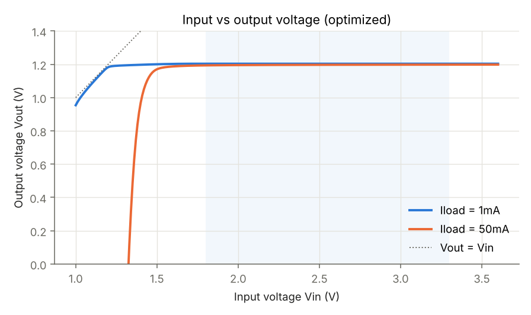
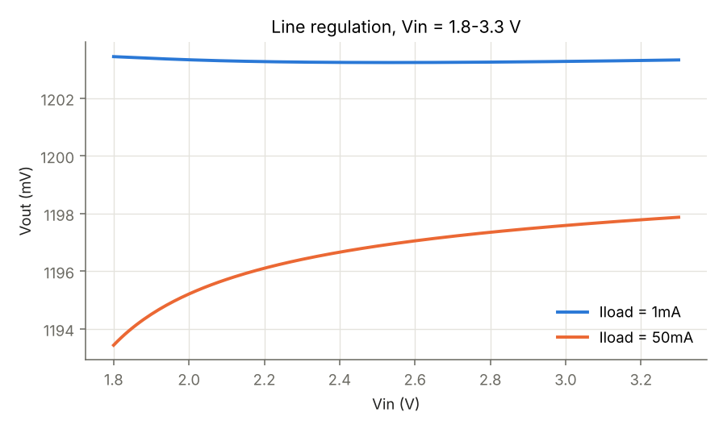
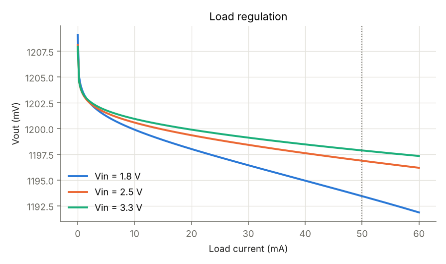
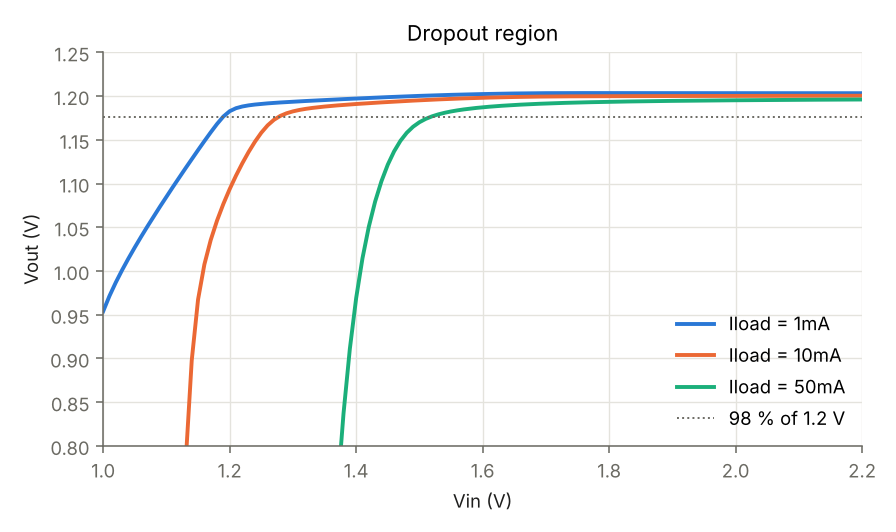
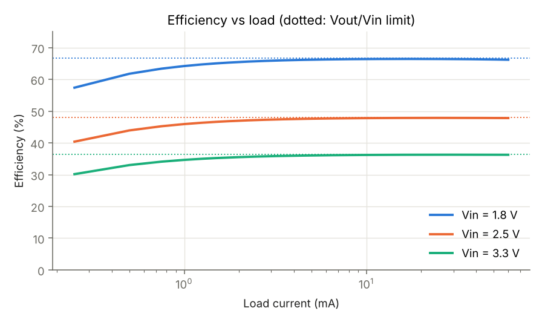
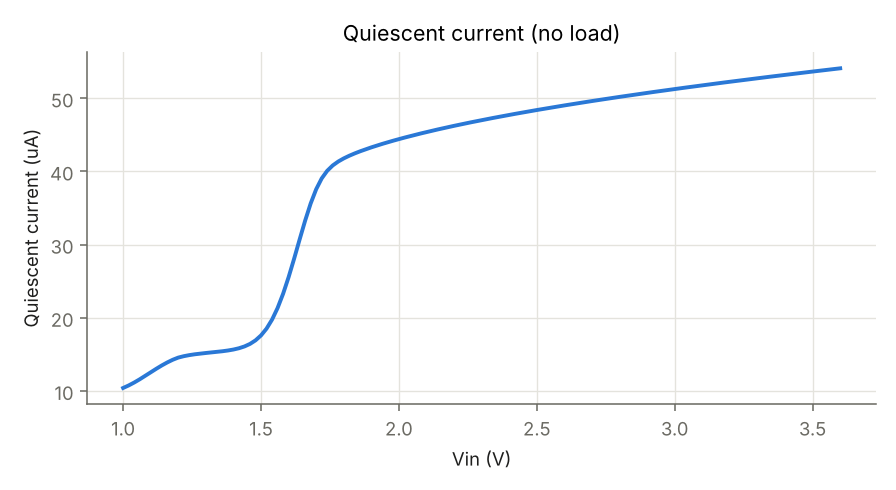
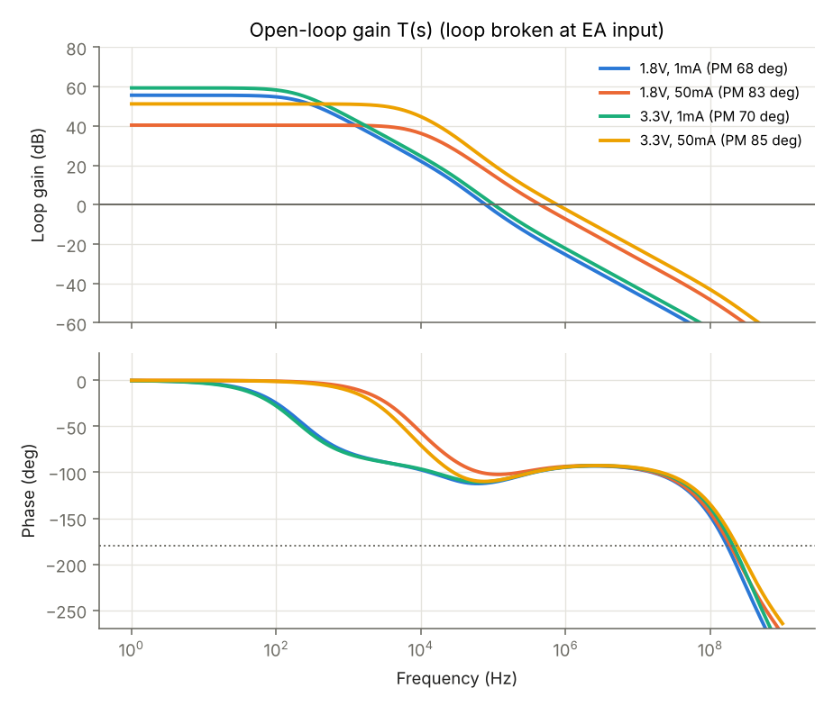
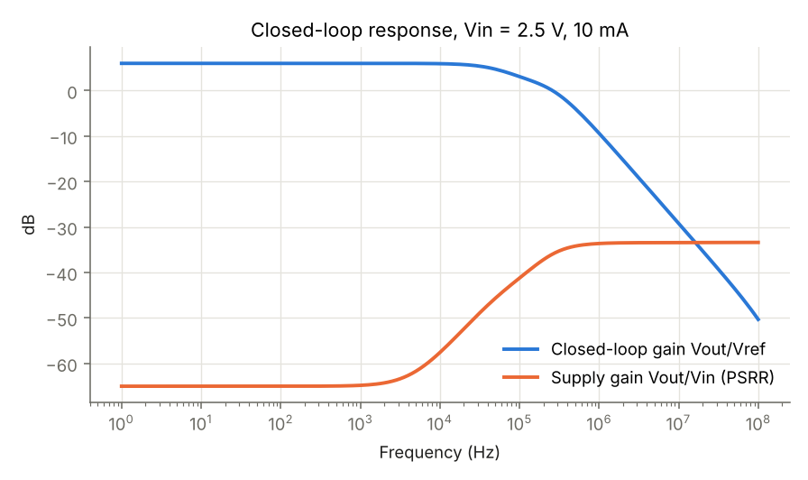
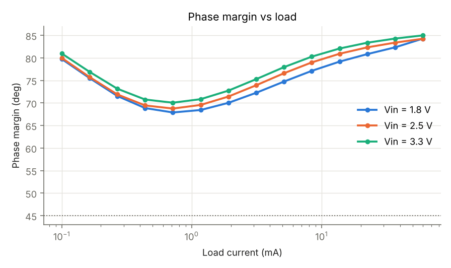
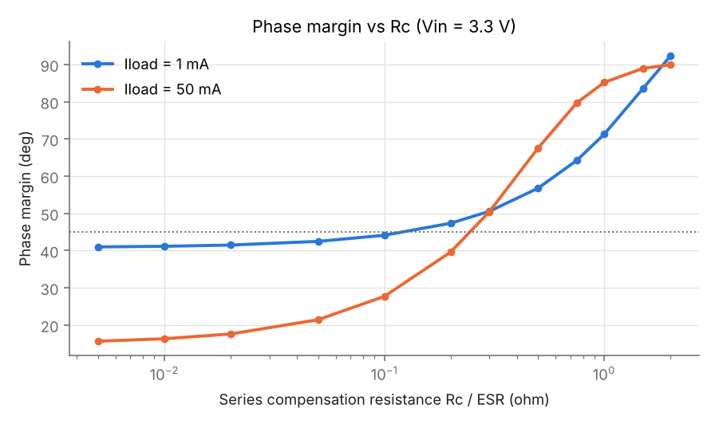
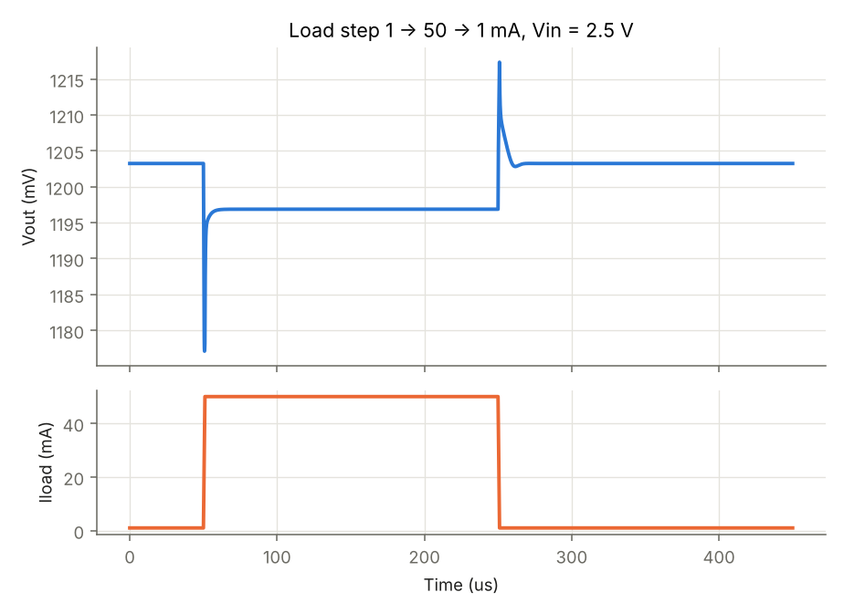
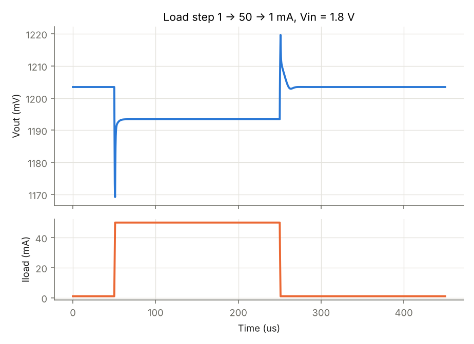
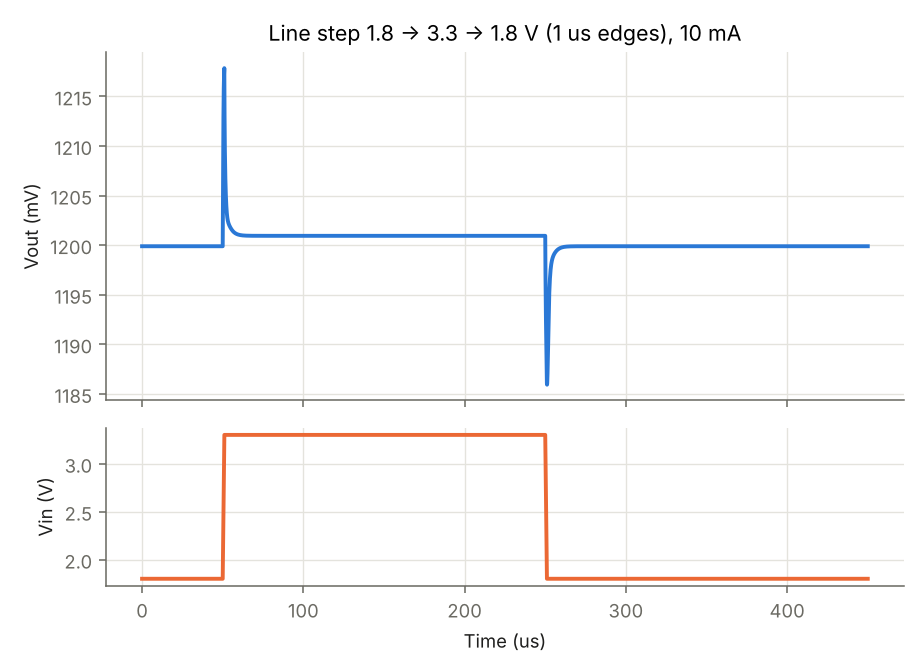

## 5. Performance analysis and stability

| load | p_out_hz | p_gate_hz | z_rc_hz | z_ff_hz | p_ff_hz | ro_pass_ohm | ro_ea_ohm | c_gate_f | gm_pass_s | vin | iload |
|---|---|---|---|---|---|---|---|---|---|---|---|
| 1mA | 202 | 5.95e+04 | 1.64e+05 | 6.12e+04 | 1.22e+05 | 2.33e+03 | 8.06e+05 | 3.32e-12 | 0.0177 | 2.5 | 0.001 |
| 50mA | 8.26e+03 | 3.78e+04 | 1.64e+05 | 6.12e+04 | 1.22e+05 | 97.7 | 8.58e+05 | 4.91e-12 | 0.224 | 2.5 | 0.05 |

## 6. Validation against targets

| test | target | measured | result | condition | note |
|---|---|---|---|---|---|
| 1. Output voltage accuracy (nominal) | 1.2 V +/- 2.0 % | 1.2006 V (+0.05 %) | PASS | tt, 27 C, 2.5 V, 10 mA |  |
| 1b. Output voltage accuracy (PVT) | +/- 2.0 % | 1.1883-1.2062 V (max 0.97 %) | PASS | 5 corners x 4 temps x 3 Vin x 2 loads | worst: sf 125C Vin=1.8 I=50mA |
| 2. Line regulation | <= 10.0 mV/V | 2.959 mV/V | PASS | Vin 1.8-3.3 V, 1 & 50 mA |  |
| 3. Load regulation | <= 0.5 mV/mA | 0.2043 mV/mA | PASS | 1-50 mA, Vin = 1.8/2.5/3.3 V (worst) |  |
| 4. Dropout voltage @ 50 mA | <= 0.6 V | 0.336 V | PASS | tt, 27 C | defined at Vout = 98 % of regulated value |
| 4b. Dropout @ 50 mA (PVT worst) | <= 0.6 V | 0.476 V | PASS | 5 corners x 4 temps |  |
| 5. Power efficiency | >= 95 % of Vout/Vin limit at 50 mA | 66.2 % @1.8 V/50 mA (limit 66.7 %), 36.3 % @3.3 V/50 mA (limit 36.4 %) | PASS | tt, 27 C | LDO efficiency is bounded by Vout/Vin |
| 6. Quiescent current | <= 100.0 uA | 52.7 uA | PASS | no load, Vin up to 3.3 V |  |
| 6b. Quiescent current (PVT worst) | <= 100.0 uA | 55.3 uA | PASS | Vin = 3.3 V, all corners/temps |  |
| 7. Phase margin | >= 45.0 deg | 68.1 deg (min) | PASS | tt, 9 Vin/load points |  |
| 7b. Phase margin (PVT) | >= 45.0 deg | 46.4 deg (min) | PASS | 120 PVT points | worst: sf -40C Vin=1.8 I=1mA |
| 8. Gain margin | >= 10.0 dB | 52.0 dB | PASS | tt, 9 Vin/load points |  |
| 9. Load transient 1<->50 mA (1 us) | <= 60.0 mV | -26.1 / +20.5 mV, settle 1.8/5.3 us | PASS | Vin = 2.5 V |  |
| 10. Temperature variation (tt) | inside accuracy window | Vout span 14.0 mV over -40..125 C, all Vin/loads | PASS | tt corner |  |
| 11. Parameter sensitivity | documented | see results/sweeps | INFO | one-at-a-time sweeps |  |
| 12. Monte Carlo yield | >= 99 % (educational model) | 97.5 % (95 % CI 94.3-98.9 %), sigma(Vout) = 11.22 mV | FAIL | 200 samples | assumed mismatch statistics |

## 7. Optimization results

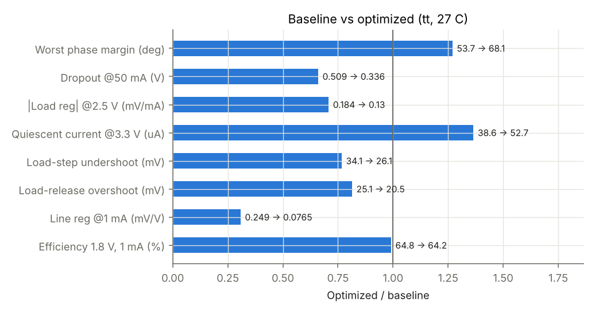

| metric | baseline | optimized |
|---|---|---|
| Worst phase margin (deg) | 53.664 | 68.1264 |
| Dropout @50 mA (V) | 0.5092 | 0.3361 |
| |Load reg| @2.5 V (mV/mA) | 0.1837 | 0.1299 |
| Quiescent current @3.3 V (uA) | 38.642 | 52.7378 |
| Load-step undershoot (mV) | 34.0689 | 26.1262 |
| Load-release overshoot (mV) | 25.1492 | 20.4676 |
| Line reg @1 mA (mV/V) | 0.2485 | 0.0765 |
| Efficiency 1.8 V, 1 mA (%) | 64.7716 | 64.184 |

## 8. PVT and Monte Carlo

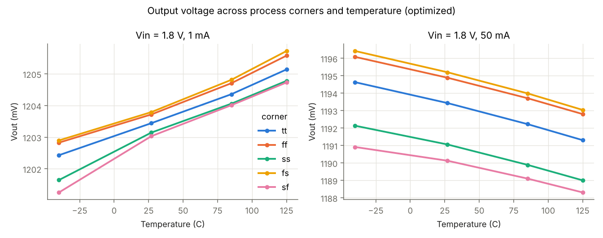
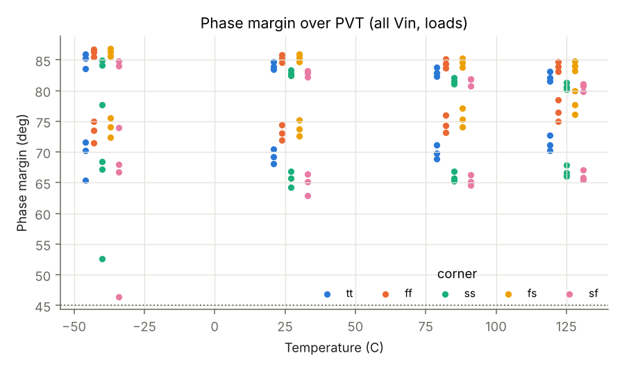
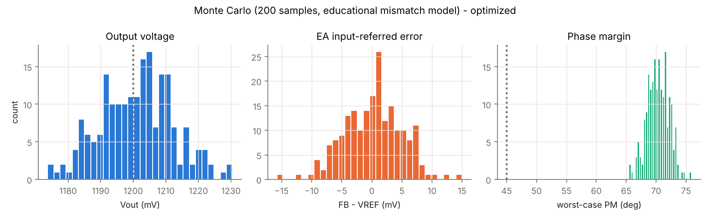
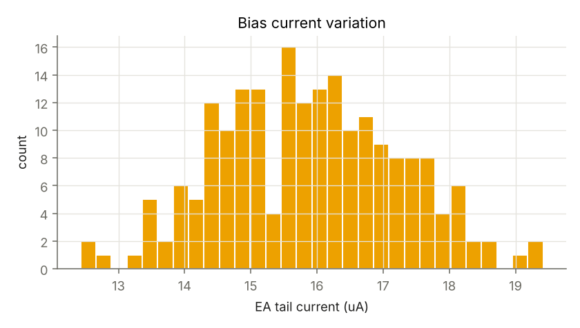

`pvt_summary.json`:

```json
{
  "n_conditions": 120,
  "n_failed_sims": 0,
  "vout_min": 1.188305,
  "vout_max": 1.206225,
  "vout_err_max_pct": 0.9745833333333342,
  "pm_min_deg": 46.3814814949705,
  "gm_min_db": 49.999184941208014,
  "all_stable": true,
  "iq_max_ua": 55.2778,
  "dropout_max_v": 0.47569628347899884,
  "worst_accuracy_condition": "sf 125C Vin=1.8 I=50mA",
  "worst_pm_condition": "sf -40C Vin=1.8 I=1mA"
}
```

`mc_summary.json`:

```json
{
  "n_samples": 200,
  "n_ok": 200,
  "seed": 2026,
  "assumptions": {
    "A_VT_mV_um": 8.0,
    "sigma_R_pct": 0.25,
    "sigma_vref_pct": 0.5,
    "sigma_iref_pct": 5.0
  },
  "vout_mean": 1.2011292199999999,
  "vout_sigma_mv": 11.223904811951082,
  "vout_min": 1.173704,
  "vout_max": 1.230471,
  "ea_offset_sigma_mv": 4.813427567167397,
  "ea_offset_mean_mv": 0.223105767192629,
  "i_tail_mean_ua": 15.89027565,
  "i_tail_sigma_ua": 1.3745011356668004,
  "ignd_mean_ua": 48.20199999999977,
  "ignd_sigma_ua": 3.3996003312243417,
  "pm_min_deg": 65.44455939217369,
  "pm_mean_deg": 70.32767806997369,
  "yield_pct": 97.5,
  "yield_ci95_pct": [
    94.28208558483828,
    98.92754385292122
  ],
  "yield_criteria": "|Vout err| <= 2.0 % at 2.5 V/10 mA and PM >= 45.0 deg"
}
```

## 9. Known limitations

- **Reference and bias current are ideal sources.** A transistor-level bandgap needs SKY130 parasitic PNP
  models that are not in the bundled minimal model set; their spread is modelled statistically instead.
- **Compensation depends on a series resistance Rc (ESR) of roughly 0.3-1 ohm** in series with Cout. With a
  low-ESR ceramic capacitor (~10 mohm) the phase margin collapses (see `pm_vs_rc.png`); an explicit on-board
  series resistor or a different compensation scheme (e.g. buffered pass gate) is required in that case.
- **Monte Carlo statistics are educational assumptions** (A_VT = 8 mV.um, 0.25 % resistor, 0.5 % Vref,
  5 % Iref). The SKY130 g5v0d10v5 cards provide only global mismatch switches, so per-device foundry
  mismatch is not available in ngspice here.
- **No layout parasitics, no package/bond-wire inductance, no ESD, no current limit / thermal shutdown /
  soft start.** Resistors and capacitors are ideal (no voltage/temperature coefficients or corners).
- **Corners are device corners only** (tt/ff/ss/fs/sf from the PDK); results are pre-layout and not
  silicon-validated.
- Loop gain is measured by breaking the loop at the EA input with an L/C DC-closure; this includes the
  divider loading and is accurate at the frequencies of interest but is not a Middlebrook/Tian
  bilateral measurement.

